# VAULT – Password Manager

A free, fully local password manager for Windows and Android, built with Next.js static export, IndexedDB (`idb`), and Web Crypto. No backend, account, cloud sync, analytics, remote fonts, or runtime external requests.

Website: [tryvault.download](https://tryvault.download)

> **Status: not independently audited.** VAULT uses well-established primitives (PBKDF2-SHA256 + AES-256-GCM via Web Crypto), but no outside firm has reviewed this code yet. The source is published so anyone can check it. Read [SECURITY.md](./SECURITY.md) and the security model below before trusting it with important data. Reviews and issue reports are very welcome.

  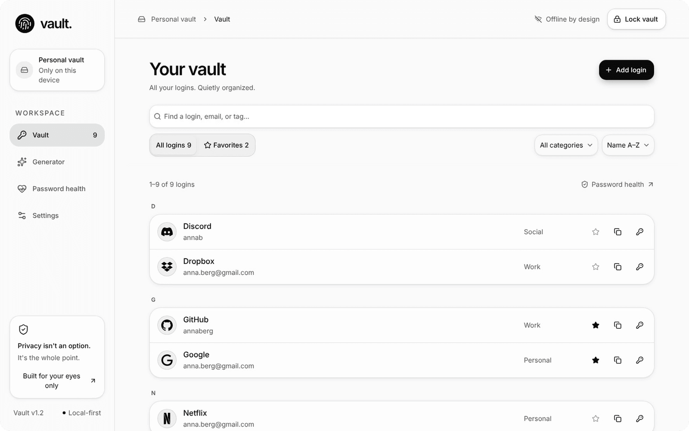

## Features

- **Big brand icons** – thousands of real brand logos are bundled in the app (via Simple Icons), so every login is recognizable at a glance. Searching for an icon never goes online.
- **Fingerprint unlock (Android)** – unlock with a touch; the session key is wrapped by the Android Keystore.
- **Autofill (Android)** – VAULT suggests the matching login when an app asks for one, so there is no copy and paste.
- **Encrypted backups** – export a password-protected `.vault` file and restore it on any device.
- **100% local** – no account, no cloud sync, no server, no analytics. Your vault stays encrypted on your device and works fully offline.
- **Open source** – the complete source is public under GPL-3.0, so anyone can review it.
- **Nine themes** – Classic, Liquid Glass, Gradient, Midnight, Ocean, Forest, Rose, Amber and Mono, each with a matching app icon.
- **Light and dark mode** – every theme has a light and a dark variant.
- **Password generator** – random passwords or passphrases from cryptographically secure randomness.
- **Password health** – a private, offline score that flags weak, reused and older passwords.
- **Windows and Android** – the same app on your PC and your phone.

## Screenshots

### Android

| Unlock | Vault | Fingerprint | Autofill |
| :---: | :---: | :---: | :---: |
| 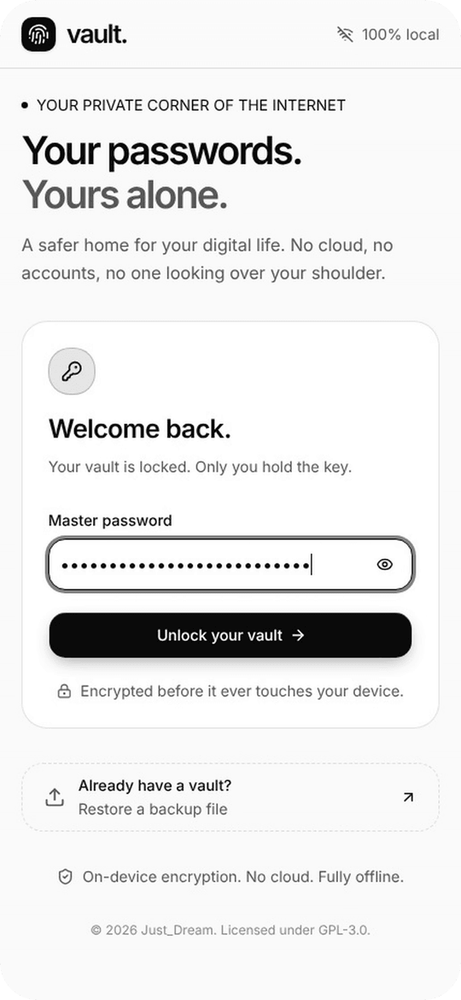 | 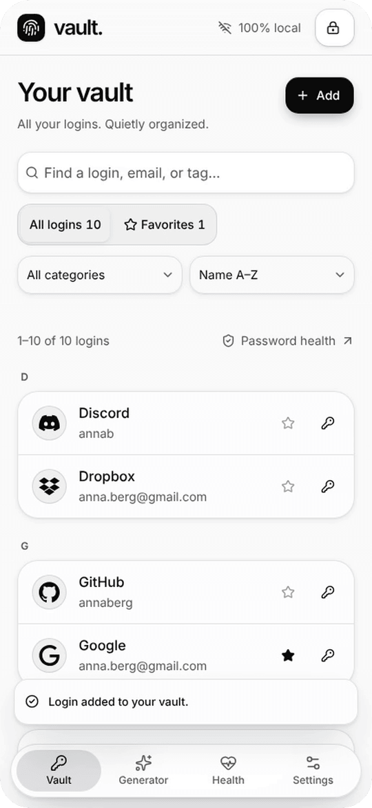 | 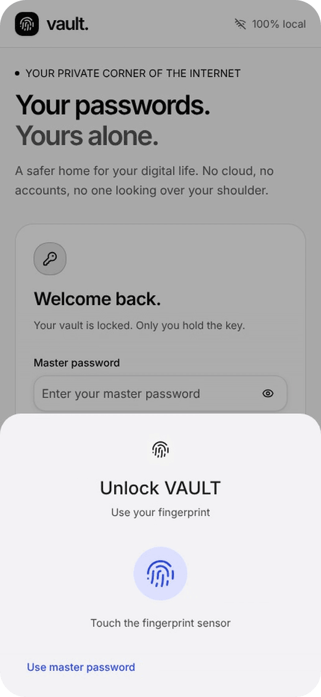 | 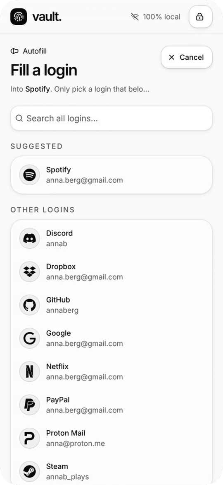 |
| **Brand icons** | **Generator** | **Health** | **Backups** |
| 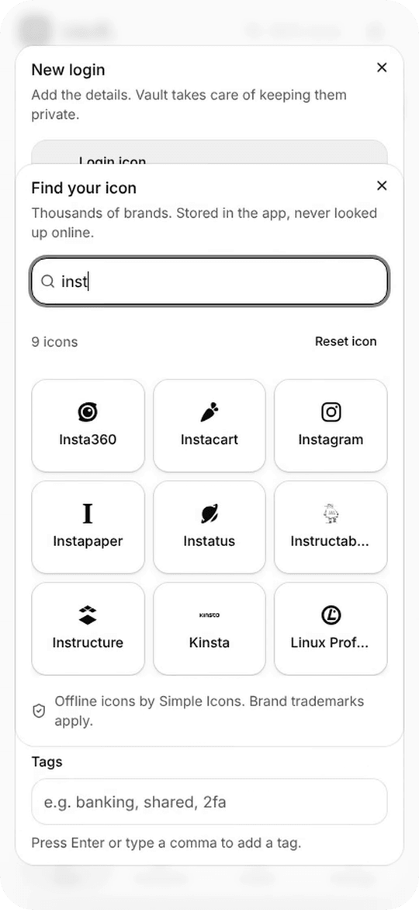 | 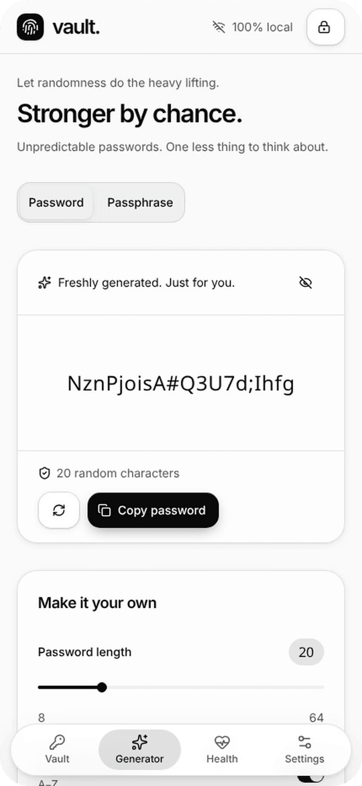 | 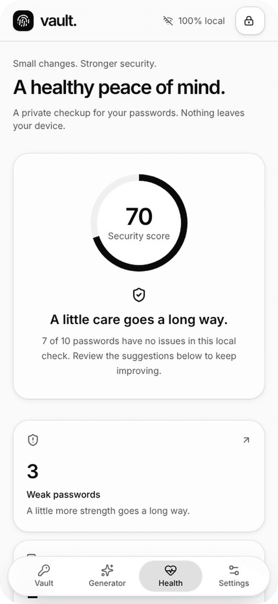 | 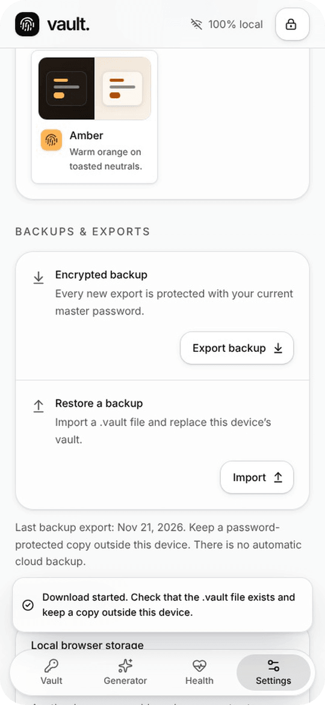 |

### Windows

| Unlock | Brand icons |
| :---: | :---: |
| 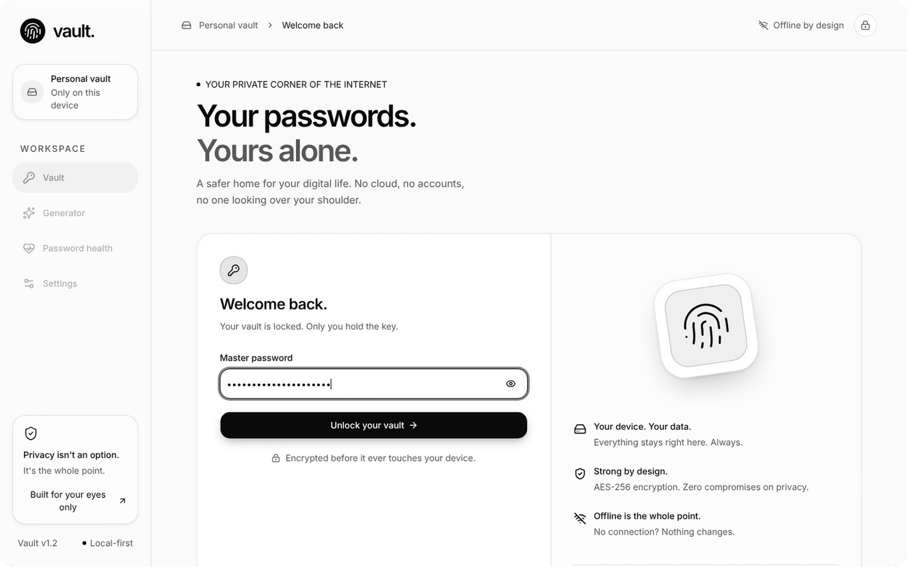 | 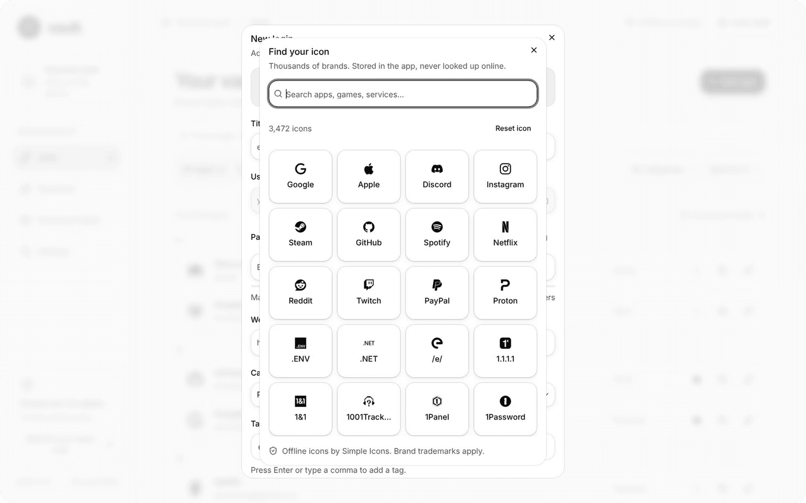 |
| **Generator** | **Health** |
| 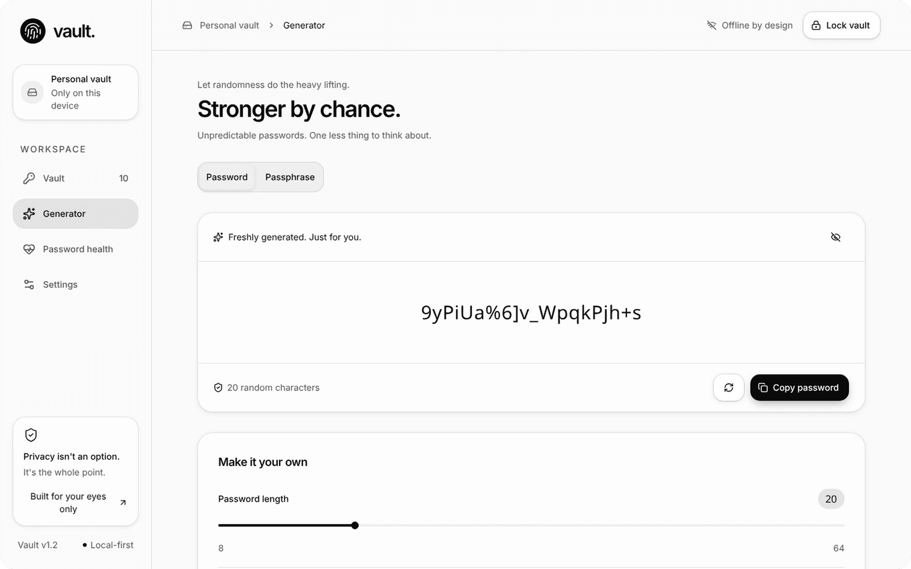 | 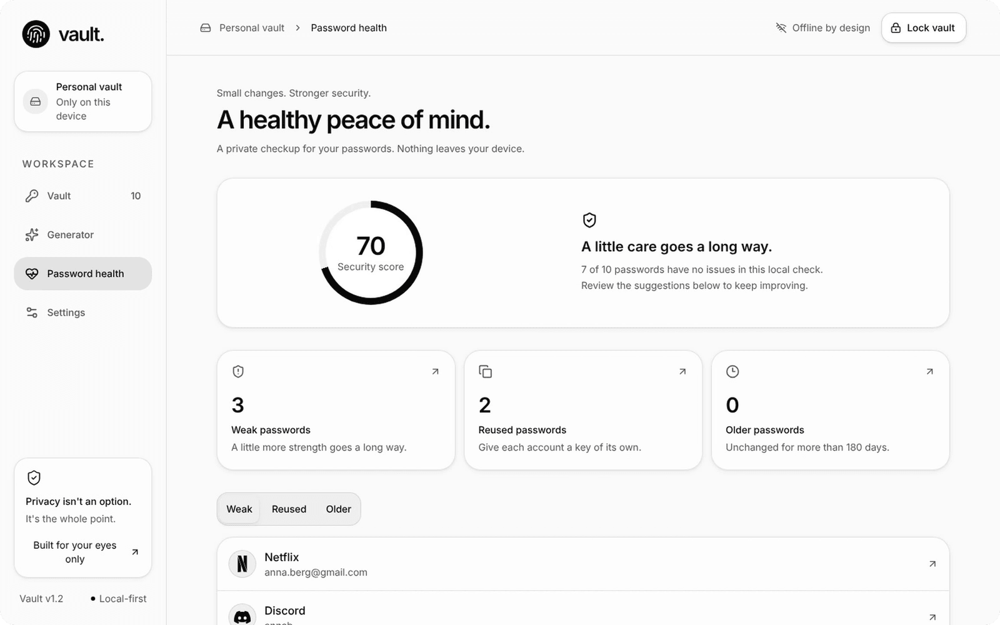 |
| **Themes and backups** | **Vault** |
| 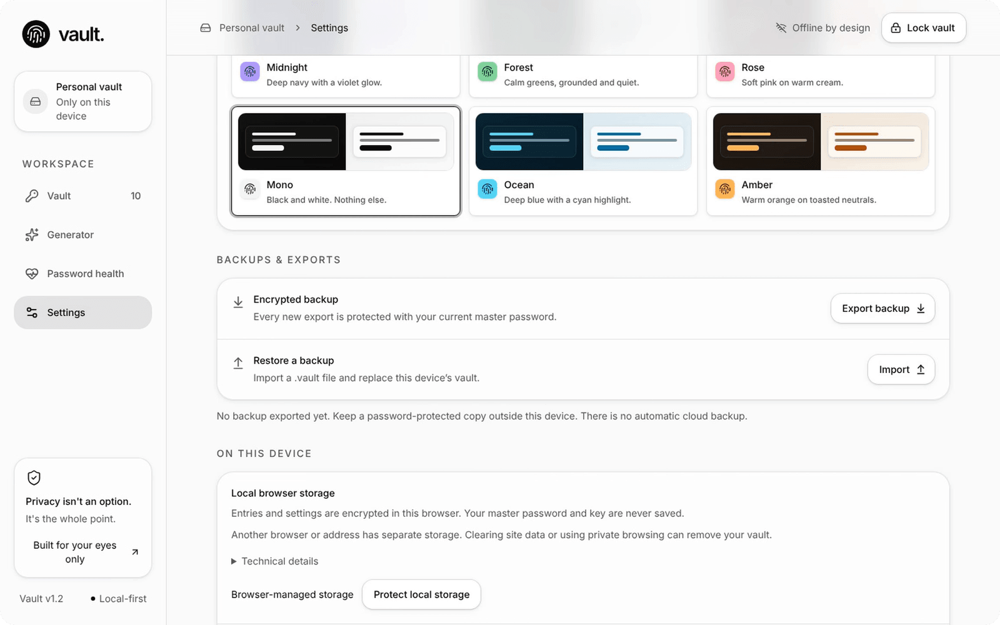 |  |

### Themes

Classic · Liquid Glass · Gradient · Midnight · Ocean · Forest · Rose · Amber · Mono

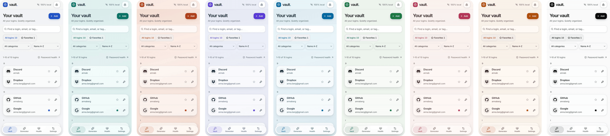

## Where to look

| What | File |
| --- | --- |
| Key derivation, encryption, file format | [`lib/crypto.ts`](./lib/crypto.ts) |
| Local storage (IndexedDB) | [`lib/db.ts`](./lib/db.ts) |
| Remembered sessions (Android Keystore wrapping) | [`lib/session.ts`](./lib/session.ts), [`SessionKeyPlugin.java`](./android/app/src/main/java/app/privatevault/test/SessionKeyPlugin.java) |
| Encrypted backups and import | [`lib/backup.ts`](./lib/backup.ts), [`lib/transfer.ts`](./lib/transfer.ts) |
| Clipboard handling | [`lib/clipboard.ts`](./lib/clipboard.ts) |
| Windows (Electron) hardening | [`desktop/main.cjs`](./desktop/main.cjs), [`desktop/security.cjs`](./desktop/security.cjs) |
| Tests | [`tests/`](./tests) |

## License

VAULT is free software, licensed under the [GNU General Public License v3.0](./LICENSE). You may use, study, modify and share it; modified versions you distribute must stay under the same license.
## Build and run

- Install: `pnpm install`
- Develop: `pnpm dev`
- Verify: `pnpm test` and `pnpm exec tsc --noEmit`
- Static export: `pnpm build` — creates `out/`, then generates an asset-complete service worker.
- Verify the exported offline cache: `node --test tests/offline.test.mjs` (after building). This uses a cache harness; also test a real offline browser reload before release.
- Preview the actual offline build: `pnpm start`.

Serve `out/` over HTTPS (localhost is also a secure context). The first browser visit downloads local application assets. After Settings reports the offline cache is ready, the app can reload without a connection. Development mode intentionally does not register a service worker. Cache updates activate after old app tabs close. Deploy response headers are provided in `vercel.json`; configure equivalent headers on other static hosts. Report-only CSP is diagnostic, not enforcing protection.

## Android test build

The Capacitor Android project is included under `android/`. It bundles `out/` with no remote server URL. The separate application ID `app.privatevault.test` and name **Vault Test** distinguish it from any future production app. Use fake credentials only; this is not an audited password manager.

### Build without a local terminal

Once the workflow is on the repository's default branch, open GitHub → Actions → **Android test APK** → **Run workflow**. Choose the branch to test. After a successful run, download the **vault-test-apk** artifact, unzip it, and install `app-debug.apk` on a test Android device. The workflow is manually triggered and keeps its APK artifact for seven days. A workflow file alone is not evidence that a build has run or passed.

The runner sets up Node 22, pnpm, Java 21 and Android SDK, checks types and security/clipboard tests, creates the offline export, syncs Capacitor, and assembles a debug-signed APK. Runner-generated debug keys may change between runs; an update may require uninstalling the prior test app, which deletes its local vault. Export any test data first.

For a workstation with Java 21 and Android SDK 36: `pnpm android:debug`. Output: `android/app/build/outputs/apk/debug/app-debug.apk`.

Native provisions include pause-to-lock, native clipboard writes, `FLAG_SECURE` screenshot/recent-app protection, backup/transfer exclusions, and encrypted backup sharing. Clipboard clearing remains best-effort if the app is suspended or killed. The encrypted share cache is overwritten on the next export. No real-device behavior is considered verified by a successful web build.

### Device regression checklist

- First launch in airplane mode; create a test vault, save a login, restart and unlock.
- Switch Classic/Liquid Glass/Gradient in light and dark mode; check text contrast and keyboard overlap.
- Copy email, plain username and password; paste into a test field and check clearing on timeout/lock.
- Background the app, use Android Back, rotate, and return: decrypted entries must not remain visible.
- Export and restore encrypted test backups; verify picker/share-sheet lifecycle and cancellation on a physical device.
- Verify screenshot blocking and no restored vault after uninstall/reinstall. Android 7+ is supported by Capacitor; a current Android System WebView is required for the modern CSS UI.

## Security model and limitations

- PBKDF2-SHA256: 600,000 iterations, random 128-bit per-vault salt; non-extractable AES-256-GCM key kept only in memory. Every save gets a new random 96-bit IV and 128-bit authentication tag; fixed format metadata is authenticated as AAD.
- The complete entries/settings payload is encrypted. Only the envelope, a revision UUID, and unlock failure counters/deadline are persisted in IndexedDB. No localStorage is used.
- Atomic revision checks prevent multi-tab overwrites. BroadcastChannel locks sibling tabs on changes. Backgrounding and inactivity discard key/decrypted state and unmount sensitive forms. In-flight encryption cannot restore a locked session.
- Persisted exponential unlock delays cap at 5 minutes. These deter casual attempts, not an attacker controlling IndexedDB or cracking an exported file offline. Use a strong, unique master password.
- Web clipboard clearing is **best-effort**: browser permissions, suspension, or process termination can prevent it. Vault retries on focus and attempts an immediate clear on lock. A scheduled clear may replace clipboard content copied elsewhere in the meantime. A native wrapper needs native clipboard handling for stronger guarantees.
- JS cannot guarantee memory zeroization. Master-password strings, browser extensions, malware, browser autofill, screenshots, and a compromised device remain risks. Protect the device; this app has not undergone an independent security audit.
- Backup import validates/decrypts before an atomic replacement, requires explicit replacement confirmation when a vault exists, and preserves existing data on errors. Backups are password-protected, not recoverable without the original password. Changing your master password does not re-key old backup files.
- Export encrypted backups regularly: clearing browser data, uninstalling, or storage eviction loses the local vault. Erasing the vault does not delete external backups, and is not forensic disk erasure.
- Health scores are local heuristics, not breach detection or proof of safety. Password age means 180 days since the password itself changed.
- Passphrases use a bundled finite word list and Web Crypto rejection sampling; the UI reports entropy from the actual list size and word count. Optional TOTP is not implemented.
